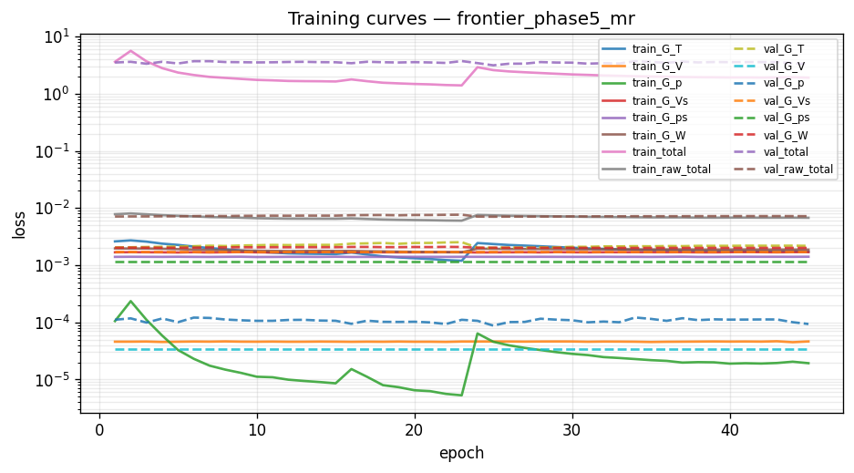
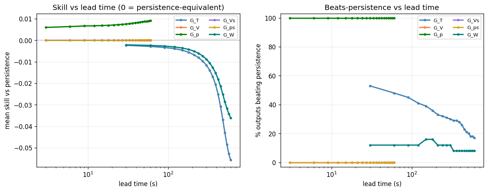
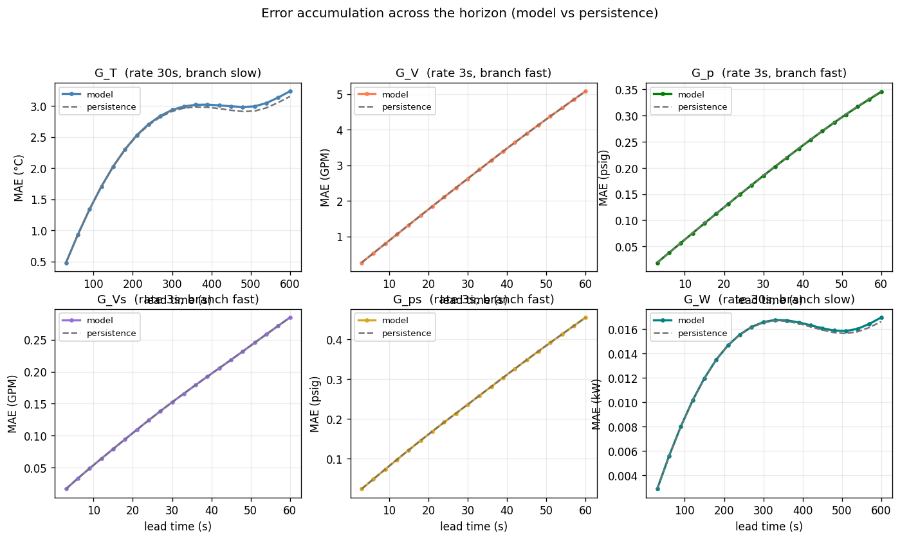
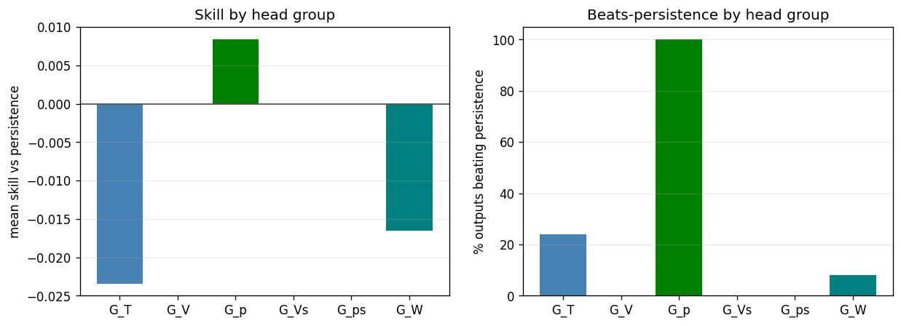

# Phase 5 (federated) — `frontier_phase5_mr`

*Generated 2026-09-30 16:26:27 · FederatedDeepMMNet · 2,273,486 parameters · 2.5 min*

## Run notes

Frontier (Simulator_olcf5_base, 25 CDUs) baseline: Phase 5 grouped DeepMMNet with the Summit-derived task spec, on systematic-25 (8 chunks x 3.23 h). Pipeline check, not a tuned model.

## Headline

| metric | value |
| --- | --- |
| Outputs | 275 |
| Mean R² | 0.5660 |
| Median R² | 0.8861 |
| Min R² | -0.5533 |
| Beats persistence | 27.6% |
| **Mean skill score** | **-0.0085** |

> Skill vs persistence is the headline metric, not mean R². Several channels sit at their noise floor, where R² is low for *any* predictor including persistence.

## Task (identical across phases 1-6 and run19b)

| group | rate (s) | history | K | window (s) | horizon (s) | branch |
| --- | --- | --- | --- | --- | --- | --- |
| G_T | 30 | 40 | 20 | 1200 | 600 | slow |
| G_V | 3 | 100 | 20 | 300 | 60 | fast |
| G_p | 3 | 100 | 20 | 300 | 60 | fast |
| G_Vs | 3 | 100 | 20 | 300 | 60 | fast |
| G_ps | 3 | 100 | 20 | 300 | 60 | fast |
| G_W | 30 | 40 | 20 | 1200 | 600 | slow |

| split | chunks | windows |
| --- | --- | --- |
| train | [1, 2, 3, 4, 6, 7] | 1,968 |
| val | [5] | 328 |
| test | [0] | 328 |

## Per head group

| group | outputs | horizon (s) | mean R² | median R² | beats | mean skill |
| --- | --- | --- | --- | --- | --- | --- |
| G_T | 100 | 600 | 0.1405 | -0.0255 | 24/100 (24%) | -0.0234 |
| G_V | 25 | 60 | 0.9818 | 0.9827 | 0/25 (0%) | +0.0000 |
| G_p | 50 | 60 | 0.9473 | 0.9473 | 50/50 (100%) | +0.0084 |
| G_Vs | 25 | 60 | 0.8917 | 0.8945 | 0/25 (0%) | +0.0000 |
| G_ps | 50 | 60 | 0.9213 | 0.9215 | 0/50 (0%) | +0.0000 |
| G_W | 25 | 600 | 0.0531 | 0.0134 | 2/25 (8%) | -0.0165 |

## Per output type

| Output_Type | R² mean | R² min | RMSE mean | MAE mean | Beats_Persistence mean |
| --- | --- | --- | --- | --- | --- |
| T_prim_r | -0.2073 | -0.5533 | 4.6860 | 3.3662 | 0.2800 |
| T_prim_s | 0.8841 | 0.8793 | 1.5093 | 1.0852 | 0.3200 |
| T_sec_r | -0.1016 | -0.4294 | 4.6451 | 3.3157 | 0.2400 |
| T_sec_s | -0.0131 | -0.4310 | 3.0674 | 2.2782 | 0.1200 |
| V_flow_prim | 0.9818 | 0.9743 | 3.6326 | 2.7239 | 0.0000 |
| V_flow_sec | 0.8917 | 0.8324 | 0.2567 | 0.1556 | 0.0000 |
| W_flow | 0.0531 | -0.4448 | 0.0187 | 0.0139 | 0.0800 |
| p_prim_r | 0.9032 | 0.9032 | 0.3969 | 0.2970 | 1.0000 |
| p_prim_s | 0.9914 | 0.9913 | 0.1106 | 0.0823 | 1.0000 |
| p_sec_r | 0.9200 | 0.8776 | 0.4526 | 0.2527 | 0.0000 |
| p_sec_s | 0.9227 | 0.8788 | 0.4288 | 0.2379 | 0.0000 |

## 20 worst outputs by R²

| Output | Group | R² | Skill_Score | RMSE |
| --- | --- | --- | --- | --- |
| simulator[1].datacenter[1].computeBlock[13].cdu[1].summary.T_prim_r_C | G_T | -0.5533 | -0.0164 | 6.9461 |
| simulator[1].datacenter[1].computeBlock[13].cdu[1].summary.W_flow_CDUP_kW | G_W | -0.4448 | -0.0077 | 0.0282 |
| simulator[1].datacenter[1].computeBlock[13].cdu[1].summary.T_sec_s_C | G_T | -0.4310 | -0.0185 | 4.6869 |
| simulator[1].datacenter[1].computeBlock[13].cdu[1].summary.T_sec_r_C | G_T | -0.4294 | -0.0152 | 6.7186 |
| simulator[1].datacenter[1].computeBlock[16].cdu[1].summary.T_prim_r_C | G_T | -0.4255 | -0.0441 | 4.3701 |
| simulator[1].datacenter[1].computeBlock[4].cdu[1].summary.T_prim_r_C | G_T | -0.4242 | -0.0037 | 5.8565 |
| simulator[1].datacenter[1].computeBlock[21].cdu[1].summary.T_prim_r_C | G_T | -0.4237 | -0.0340 | 3.8114 |
| simulator[1].datacenter[1].computeBlock[2].cdu[1].summary.T_prim_r_C | G_T | -0.4078 | -0.0351 | 4.7057 |
| simulator[1].datacenter[1].computeBlock[7].cdu[1].summary.T_prim_r_C | G_T | -0.3978 | -0.0059 | 5.4171 |
| simulator[1].datacenter[1].computeBlock[4].cdu[1].summary.T_sec_r_C | G_T | -0.3905 | -0.0068 | 5.8143 |
| simulator[1].datacenter[1].computeBlock[9].cdu[1].summary.T_prim_r_C | G_T | -0.3775 | 0.0149 | 6.1114 |
| simulator[1].datacenter[1].computeBlock[22].cdu[1].summary.T_prim_r_C | G_T | -0.3555 | 0.0006 | 5.4114 |
| simulator[1].datacenter[1].computeBlock[21].cdu[1].summary.T_sec_r_C | G_T | -0.3439 | -0.0589 | 3.7683 |
| simulator[1].datacenter[1].computeBlock[20].cdu[1].summary.T_prim_r_C | G_T | -0.3355 | -0.0234 | 5.0528 |
| simulator[1].datacenter[1].computeBlock[18].cdu[1].summary.T_prim_r_C | G_T | -0.3313 | -0.0818 | 4.7575 |
| simulator[1].datacenter[1].computeBlock[25].cdu[1].summary.T_prim_r_C | G_T | -0.3259 | 0.0150 | 5.3851 |
| simulator[1].datacenter[1].computeBlock[2].cdu[1].summary.T_sec_r_C | G_T | -0.3083 | -0.0523 | 4.7440 |
| simulator[1].datacenter[1].computeBlock[9].cdu[1].summary.T_sec_r_C | G_T | -0.3009 | 0.0244 | 5.9685 |
| simulator[1].datacenter[1].computeBlock[7].cdu[1].summary.T_sec_r_C | G_T | -0.2947 | -0.0150 | 5.4844 |
| simulator[1].datacenter[1].computeBlock[24].cdu[1].summary.T_prim_r_C | G_T | -0.2851 | -0.0033 | 4.4685 |

## Figures

### Training and validation loss per epoch.



### Skill and beats-persistence fraction versus lead time.



### Mean absolute error across the horizon, model versus persistence, per head.



### Per-head-group skill and beats-persistence.



## Full console log

```text
==========================================================================
PHASE 5 — federated   [frontier_phase5_mr]
==========================================================================
device: cuda:0
multi_rate: True   store rates (s): [3, 30]
group   rate(s)  history    K  window(s)  horizon(s)  branch
G_T          30       40   20       1200         600  slow
G_V           3      100   20        300          60  fast
G_p           3      100   20        300          60  fast
G_Vs          3      100   20        300          60  fast
G_ps          3      100   20        300          60  fast
G_W          30       40   20       1200         600  slow
data dir: /home/w1b/exa/data/frontier/systematic-25

============================================================
COLUMN IDENTIFICATION (Federated)
============================================================
Input columns:              26
Total dynamic outputs:      275
  G_T  (temperatures):      100
  G_V  (prim flow):         25
  G_p  (prim pressure):     50
  G_Vs (sec flow):          25
  G_ps (sec pressure):      50
  G_W  (pump power):        25
  Per-type index maps:      11 types

inputs: 26   dynamic outputs: 275
[store] present, reusing: /home/w1b/exa/data/frontier/systematic-25/store
[norm] loading shared normalizer: /home/w1b/exa/data/frontier/systematic-25/store/normalizer_shared.json
FederatedNormalizer loaded from /home/w1b/exa/data/frontier/systematic-25/store/normalizer_shared.json
loader workers: 6   batch: 256
Federated store [chunk split]: train=[1, 2, 3, 4, 6, 7] val=[5] test=[0] | multi_rate=True rates=[3, 30]
  windows: train=1968 val=328 test=328
DATA MANIFEST: {'train_chunks': [1, 2, 3, 4, 6, 7], 'val_chunks': [5], 'test_chunks': [0], 'windows': {'train': 1968, 'val': 328, 'test': 328}}

model: FederatedDeepMMNet   parameters: 2,273,486

--------------------------------------------------------------------------
TRAINING
--------------------------------------------------------------------------

======================================================================
PER-HEAD LOSS NORMALISATION (persistence baseline)
======================================================================
  head       baseline    cfg_w    effective
  G_T    2.571589e-03     1.00   3.8886e+02
  G_V    4.537733e-05     0.00   0.0000e+00
  G_p    6.549651e-05     1.00   1.5268e+04
  G_Vs   1.698397e-03     0.00   0.0000e+00
  G_ps   1.401437e-03     0.00   0.0000e+00
  G_W    1.971237e-03     1.00   5.0730e+02


======================================================================
TRAINING — Phase 5: Federated DeepMMNet
======================================================================

======================================================================
PHASE 1: Round-Robin Training (6 Decoder Heads)
======================================================================

Phase 1 early stopping at epoch 23
Phase 1 best validation loss: 3.350524

======================================================================
PHASE 2: Joint Fine-Tuning (6 Heads)
  Encoder LR: 0.001
  Head LR:    0.0001
======================================================================

Phase 2 early stopping at epoch 22
Phase 2 best validation loss: 3.147639

Total training time: 144.9s

training done in 2.4 min   best val 3.147639 @ epoch 25
FederatedNormalizer saved to runs/frontier_phase5_mr/normalizer.json

--------------------------------------------------------------------------
EVALUATION (test split)
--------------------------------------------------------------------------
======================================================================
RESULTS SUMMARY — frontier_phase5_mr
======================================================================

--- All 275 Outputs ---
  Mean/Median R²:    0.5660 / 0.8861
  Min R²:            -0.5533
  Beats Persistence: 76/275 (27.6%)
  Mean Skill Score:  -0.0085

--- Per Decoder Head Group ---

  G_T (100 outputs, horizon 600s):
    Mean/Median R²: 0.1405 / -0.0255   Beats: 24/100 (24.0%)   Skill: -0.0234   R²-margin: -1.93e-02

  G_V (25 outputs, horizon 60s):
    Mean/Median R²: 0.9818 / 0.9827   Beats: 0/25 (0.0%)   Skill: +0.0000   R²-margin: +0.00e+00

  G_p (50 outputs, horizon 60s):
    Mean/Median R²: 0.9473 / 0.9473   Beats: 50/50 (100.0%)   Skill: +0.0084   R²-margin: +2.88e-04

  G_Vs (25 outputs, horizon 60s):
    Mean/Median R²: 0.8917 / 0.8945   Beats: 0/25 (0.0%)   Skill: +0.0000   R²-margin: +0.00e+00

  G_ps (50 outputs, horizon 60s):
    Mean/Median R²: 0.9213 / 0.9215   Beats: 0/50 (0.0%)   Skill: +0.0000   R²-margin: +0.00e+00

  G_W (25 outputs, horizon 600s):
    Mean/Median R²: 0.0531 / 0.0134   Beats: 2/25 (8.0%)   Skill: -0.0165   R²-margin: -1.47e-02

--- Per Output Type ---
                 R²            RMSE     MAE Beats_Persistence Variance_Ratio
               mean     min    mean    mean              mean           mean
Output_Type                                                                 
T_prim_r    -0.2073 -0.5533  4.6860  3.3662              0.28         0.9710
T_prim_s     0.8841  0.8793  1.5093  1.0852              0.32         1.0194
T_sec_r     -0.1016 -0.4294  4.6451  3.3157              0.24         0.9583
T_sec_s     -0.0131 -0.4310  3.0674  2.2782              0.12         0.9752
V_flow_prim  0.9818  0.9743  3.6326  2.7239              0.00         0.9977
V_flow_sec   0.8917  0.8324  0.2567  0.1556              0.00         0.9991
W_flow       0.0531 -0.4448  0.0187  0.0139              0.08         1.0245
p_prim_r     0.9032  0.9032  0.3969  0.2970              1.00         0.9836
p_prim_s     0.9914  0.9913  0.1106  0.0823              1.00         0.9973
p_sec_r      0.9200  0.8776  0.4526  0.2527              0.00         1.0002
p_sec_s      0.9227  0.8788  0.4288  0.2379              0.00         1.0003
```

## Artifacts

- `config.json`
- `data_manifest.json`
- `error_accum.png`
- `group_summary.png`
- `history.json`
- `metrics.csv`
- `model.pt`
- `normalizer.json`
- `notes.txt`
- `per_step.npy`
- `phase_summary.json`
- `run_log.txt`
- `skill_vs_lead.png`
- `training_curves.png`
