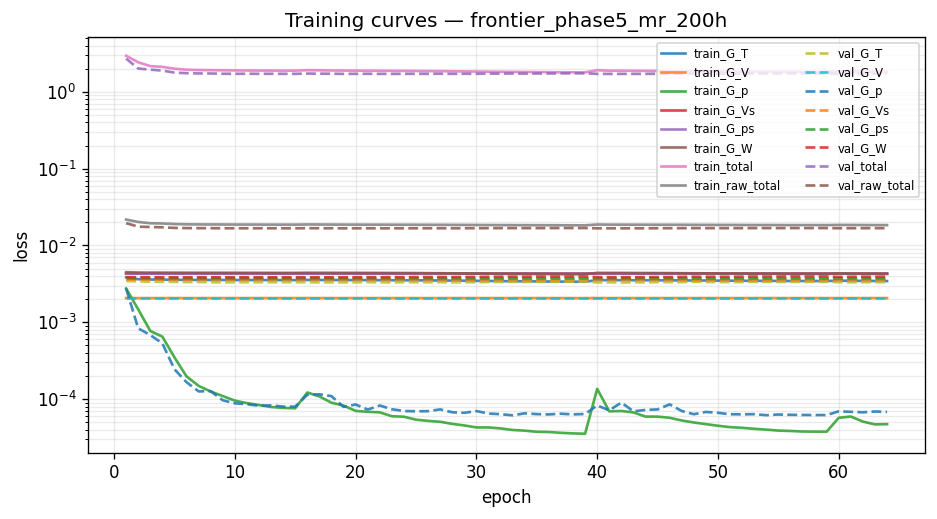
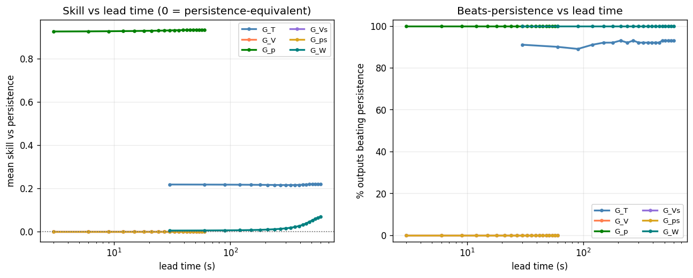
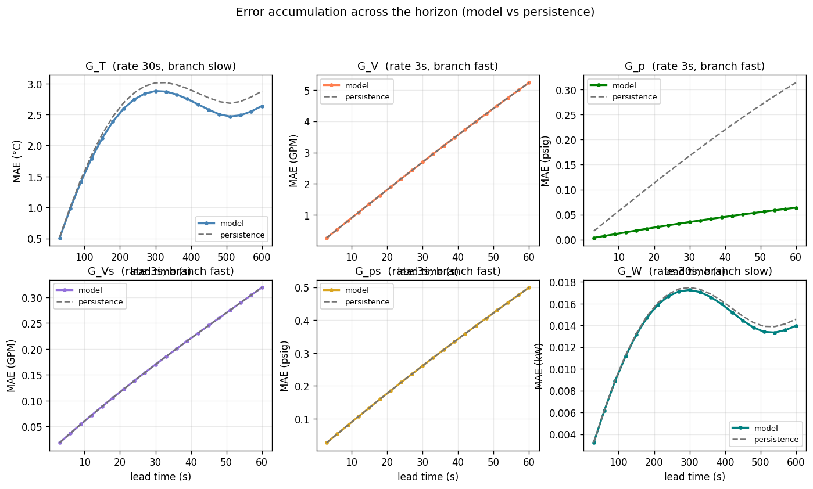
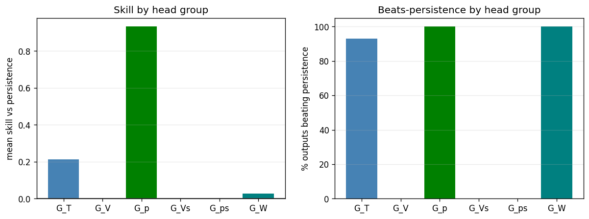

# Phase 5 (federated) — `frontier_phase5_mr_200h`

*Generated 2026-09-30 20:10:39 · FederatedDeepMMNet · 2,273,486 parameters · 12.0 min*

## Run notes

Frontier (Simulator_olcf5_base, 25 CDUs) baseline: Phase 5 grouped DeepMMNet with the Summit-derived task spec, on systematic-25 (8 chunks x 3.23 h). Pipeline check, not a tuned model.

## Headline

| metric | value |
| --- | --- |
| Outputs | 275 |
| Mean R² | 0.5157 |
| Median R² | 0.9024 |
| Min R² | -0.4896 |
| Beats persistence | 61.1% |
| **Mean skill score** | **+0.2492** |

> Skill vs persistence is the headline metric, not mean R². Several channels sit at their noise floor, where R² is low for *any* predictor including persistence.

## Task (identical across phases 1-6 and run19b)

| group | rate (s) | history | K | window (s) | horizon (s) | branch |
| --- | --- | --- | --- | --- | --- | --- |
| G_T | 30 | 40 | 20 | 1200 | 600 | slow |
| G_V | 3 | 100 | 20 | 300 | 60 | fast |
| G_p | 3 | 100 | 20 | 300 | 60 | fast |
| G_Vs | 3 | 100 | 20 | 300 | 60 | fast |
| G_ps | 3 | 100 | 20 | 300 | 60 | fast |
| G_W | 30 | 40 | 20 | 1200 | 600 | slow |

| split | chunks | windows |
| --- | --- | --- |
| train | [0, 2, 3, 5, 6, 7, 9, 10, 11, 12, 14, 15, 16, 17, 18, 19, 20, 22, 23] | 17,974 |
| val | [4, 21] | 1,892 |
| test | [1, 8, 13] | 2,838 |

## Per head group

| group | outputs | horizon (s) | mean R² | median R² | beats | mean skill |
| --- | --- | --- | --- | --- | --- | --- |
| G_T | 100 | 600 | 0.0631 | -0.2003 | 93/100 (93%) | +0.2123 |
| G_V | 25 | 60 | 0.9764 | 0.9768 | 0/25 (0%) | +0.0000 |
| G_p | 50 | 60 | 0.9971 | 0.9971 | 50/50 (100%) | +0.9329 |
| G_Vs | 25 | 60 | 0.8604 | 0.8602 | 0/25 (0%) | +0.0000 |
| G_ps | 50 | 60 | 0.9075 | 0.9063 | 0/50 (0%) | +0.0000 |
| G_W | 25 | 600 | -0.2260 | -0.2364 | 25/25 (100%) | +0.0267 |

## Per output type

| Output_Type | R² mean | R² min | RMSE mean | MAE mean | Beats_Persistence mean |
| --- | --- | --- | --- | --- | --- |
| T_prim_r | -0.3086 | -0.4896 | 4.9192 | 3.4357 | 0.8400 |
| T_prim_s | 0.9835 | 0.9835 | 0.5024 | 0.2779 | 1.0000 |
| T_sec_r | -0.1937 | -0.3706 | 4.8450 | 3.3543 | 0.8800 |
| T_sec_s | -0.2288 | -0.3833 | 3.1611 | 2.2492 | 1.0000 |
| V_flow_prim | 0.9764 | 0.9735 | 3.7720 | 2.7967 | 0.0000 |
| V_flow_sec | 0.8604 | 0.8511 | 0.2870 | 0.1744 | 0.0000 |
| W_flow | -0.2260 | -0.3763 | 0.0191 | 0.0136 | 1.0000 |
| p_prim_r | 0.9950 | 0.9950 | 0.0787 | 0.0512 | 1.0000 |
| p_prim_s | 0.9992 | 0.9992 | 0.0296 | 0.0204 | 1.0000 |
| p_sec_r | 0.9058 | 0.8929 | 0.4959 | 0.2778 | 0.0000 |
| p_sec_s | 0.9091 | 0.8958 | 0.4691 | 0.2612 | 0.0000 |

## 20 worst outputs by R²

| Output | Group | R² | Skill_Score | RMSE |
| --- | --- | --- | --- | --- |
| simulator[1].datacenter[1].computeBlock[9].cdu[1].summary.T_prim_r_C | G_T | -0.4896 | -0.0018 | 5.0061 |
| simulator[1].datacenter[1].computeBlock[24].cdu[1].summary.T_prim_r_C | G_T | -0.4270 | -0.0040 | 5.7313 |
| simulator[1].datacenter[1].computeBlock[25].cdu[1].summary.T_prim_r_C | G_T | -0.4246 | -0.0171 | 4.9847 |
| simulator[1].datacenter[1].computeBlock[8].cdu[1].summary.T_prim_r_C | G_T | -0.4065 | 0.0238 | 4.9136 |
| simulator[1].datacenter[1].computeBlock[9].cdu[1].summary.T_sec_s_C | G_T | -0.3833 | 0.0129 | 3.2168 |
| simulator[1].datacenter[1].computeBlock[21].cdu[1].summary.T_prim_r_C | G_T | -0.3797 | 0.0121 | 4.5284 |
| simulator[1].datacenter[1].computeBlock[9].cdu[1].summary.W_flow_CDUP_kW | G_W | -0.3763 | 0.0150 | 0.0194 |
| simulator[1].datacenter[1].computeBlock[3].cdu[1].summary.T_prim_r_C | G_T | -0.3742 | 0.0119 | 5.4007 |
| simulator[1].datacenter[1].computeBlock[20].cdu[1].summary.T_prim_r_C | G_T | -0.3726 | 0.0072 | 4.2290 |
| simulator[1].datacenter[1].computeBlock[9].cdu[1].summary.T_sec_r_C | G_T | -0.3706 | 0.0012 | 4.9191 |
| simulator[1].datacenter[1].computeBlock[19].cdu[1].summary.T_prim_r_C | G_T | -0.3706 | -0.0116 | 5.0631 |
| simulator[1].datacenter[1].computeBlock[16].cdu[1].summary.T_prim_r_C | G_T | -0.3575 | 0.0207 | 5.0697 |
| simulator[1].datacenter[1].computeBlock[14].cdu[1].summary.T_prim_r_C | G_T | -0.3471 | 0.0043 | 5.4823 |
| simulator[1].datacenter[1].computeBlock[18].cdu[1].summary.T_prim_r_C | G_T | -0.3348 | 0.0145 | 4.7982 |
| simulator[1].datacenter[1].computeBlock[13].cdu[1].summary.T_prim_r_C | G_T | -0.3335 | 0.0334 | 4.8977 |
| simulator[1].datacenter[1].computeBlock[24].cdu[1].summary.T_sec_r_C | G_T | -0.3286 | -0.0030 | 5.6877 |
| simulator[1].datacenter[1].computeBlock[25].cdu[1].summary.T_sec_r_C | G_T | -0.3285 | -0.0173 | 4.9330 |
| simulator[1].datacenter[1].computeBlock[17].cdu[1].summary.T_prim_r_C | G_T | -0.3283 | 0.0083 | 4.9592 |
| simulator[1].datacenter[1].computeBlock[24].cdu[1].summary.T_sec_s_C | G_T | -0.3264 | 0.0054 | 3.6082 |
| simulator[1].datacenter[1].computeBlock[7].cdu[1].summary.T_prim_r_C | G_T | -0.3250 | 0.0162 | 5.2045 |

## Figures

### Training and validation loss per epoch.



### Skill and beats-persistence fraction versus lead time.



### Mean absolute error across the horizon, model versus persistence, per head.



### Per-head-group skill and beats-persistence.



## Full console log

```text
==========================================================================
PHASE 5 — federated   [frontier_phase5_mr_200h]
==========================================================================
device: cuda:0
multi_rate: True   store rates (s): [3, 30]
group   rate(s)  history    K  window(s)  horizon(s)  branch
G_T          30       40   20       1200         600  slow
G_V           3      100   20        300          60  fast
G_p           3      100   20        300          60  fast
G_Vs          3      100   20        300          60  fast
G_ps          3      100   20        300          60  fast
G_W          30       40   20       1200         600  slow
data dir: /home/w1b/exa/data/frontier/systematic-200

============================================================
COLUMN IDENTIFICATION (Federated)
============================================================
Input columns:              26
Total dynamic outputs:      275
  G_T  (temperatures):      100
  G_V  (prim flow):         25
  G_p  (prim pressure):     50
  G_Vs (sec flow):          25
  G_ps (sec pressure):      50
  G_W  (pump power):        25
  Per-type index maps:      11 types

inputs: 26   dynamic outputs: 275
[store] present, reusing: /home/w1b/exa/data/frontier/systematic-200/store
[norm] loading shared normalizer: /home/w1b/exa/data/frontier/systematic-200/store/normalizer_shared.json
FederatedNormalizer loaded from /home/w1b/exa/data/frontier/systematic-200/store/normalizer_shared.json
loader workers: 8   batch: 256
Federated store [chunk split]: train=[0, 2, 3, 5, 6, 7, 9, 10, 11, 12, 14, 15, 16, 17, 18, 19, 20, 22, 23] val=[4, 21] test=[1, 8, 13] | multi_rate=True rates=[3, 30]
  windows: train=17974 val=1892 test=2838
DATA MANIFEST: {'train_chunks': [0, 2, 3, 5, 6, 7, 9, 10, 11, 12, 14, 15, 16, 17, 18, 19, 20, 22, 23], 'val_chunks': [4, 21], 'test_chunks': [1, 8, 13], 'windows': {'train': 17974, 'val': 1892, 'test': 2838}}

model: FederatedDeepMMNet   parameters: 2,273,486

--------------------------------------------------------------------------
TRAINING
--------------------------------------------------------------------------

======================================================================
PER-HEAD LOSS NORMALISATION (persistence baseline)
======================================================================
  head       baseline    cfg_w    effective
  G_T    3.993333e-03     1.00   2.5042e+02
  G_V    2.065340e-03     0.00   0.0000e+00
  G_p    2.764306e-03     1.00   3.6175e+02
  G_Vs   4.315114e-03     0.00   0.0000e+00
  G_ps   4.291548e-03     0.00   0.0000e+00
  G_W    4.498793e-03     1.00   2.2228e+02


======================================================================
TRAINING — Phase 5: Federated DeepMMNet
======================================================================

======================================================================
PHASE 1: Round-Robin Training (6 Decoder Heads)
======================================================================

Phase 1 early stopping at epoch 39
Phase 1 best validation loss: 1.715336

======================================================================
PHASE 2: Joint Fine-Tuning (6 Heads)
  Encoder LR: 0.001
  Head LR:    0.0001
======================================================================

Phase 2 early stopping at epoch 25
Phase 2 best validation loss: 1.715538
Phase 2 (1.715538) worse than Phase 1 (1.715336) — restored Phase 1 weights.

Total training time: 713.8s

training done in 12.0 min   best val 1.715336 @ epoch 19
FederatedNormalizer saved to runs/frontier_phase5_mr_200h/normalizer.json

--------------------------------------------------------------------------
EVALUATION (test split)
--------------------------------------------------------------------------
======================================================================
RESULTS SUMMARY — frontier_phase5_mr_200h
======================================================================

--- All 275 Outputs ---
  Mean/Median R²:    0.5157 / 0.9024
  Min R²:            -0.4896
  Beats Persistence: 168/275 (61.1%)
  Mean Skill Score:  +0.2492

--- Per Decoder Head Group ---

  G_T (100 outputs, horizon 600s):
    Mean/Median R²: 0.0631 / -0.2003   Beats: 93/100 (93.0%)   Skill: +0.2123   R²-margin: +3.02e-02

  G_V (25 outputs, horizon 60s):
    Mean/Median R²: 0.9764 / 0.9768   Beats: 0/25 (0.0%)   Skill: +0.0000   R²-margin: +0.00e+00

  G_p (50 outputs, horizon 60s):
    Mean/Median R²: 0.9971 / 0.9971   Beats: 50/50 (100.0%)   Skill: +0.9329   R²-margin: +5.26e-02

  G_Vs (25 outputs, horizon 60s):
    Mean/Median R²: 0.8604 / 0.8602   Beats: 0/25 (0.0%)   Skill: +0.0000   R²-margin: +0.00e+00

  G_ps (50 outputs, horizon 60s):
    Mean/Median R²: 0.9075 / 0.9063   Beats: 0/50 (0.0%)   Skill: +0.0000   R²-margin: +0.00e+00

  G_W (25 outputs, horizon 600s):
    Mean/Median R²: -0.2260 / -0.2364   Beats: 25/25 (100.0%)   Skill: +0.0267   R²-margin: +3.33e-02

--- Per Output Type ---
                 R²            RMSE     MAE Beats_Persistence Variance_Ratio
               mean     min    mean    mean              mean           mean
Output_Type                                                                 
T_prim_r    -0.3086 -0.4896  4.9192  3.4357              0.84         0.9977
T_prim_s     0.9835  0.9835  0.5024  0.2779              1.00         1.0027
T_sec_r     -0.1937 -0.3706  4.8450  3.3543              0.88         0.9934
T_sec_s     -0.2288 -0.3833  3.1611  2.2492              1.00         1.0178
V_flow_prim  0.9764  0.9735  3.7720  2.7967              0.00         1.0001
V_flow_sec   0.8604  0.8511  0.2870  0.1744              0.00         0.9997
W_flow      -0.2260 -0.3763  0.0191  0.0136              1.00         0.9990
p_prim_r     0.9950  0.9950  0.0787  0.0512              1.00         0.9992
p_prim_s     0.9992  0.9992  0.0296  0.0204              1.00         1.0006
p_sec_r      0.9058  0.8929  0.4959  0.2778              0.00         0.9999
p_sec_s      0.9091  0.8958  0.4691  0.2612              0.00         0.9999
```

## Artifacts

- `config.json`
- `data_manifest.json`
- `error_accum.png`
- `group_summary.png`
- `history.json`
- `metrics.csv`
- `model.pt`
- `normalizer.json`
- `notes.txt`
- `per_step.npy`
- `phase_summary.json`
- `run_log.txt`
- `skill_vs_lead.png`
- `training_curves.png`
