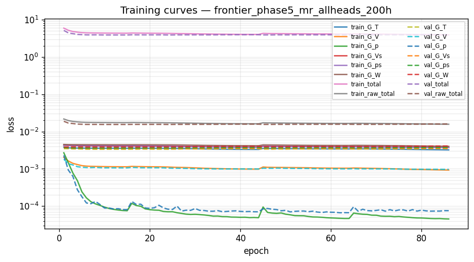
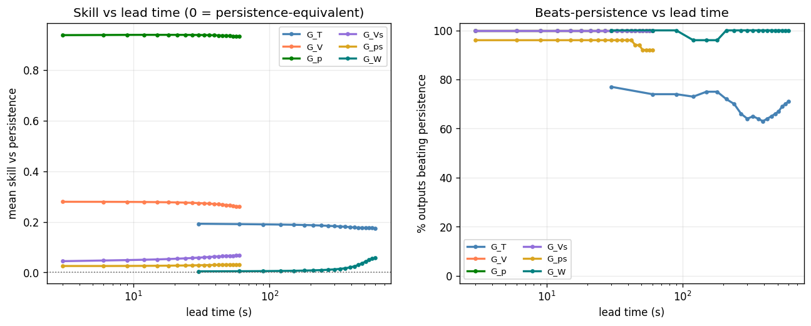
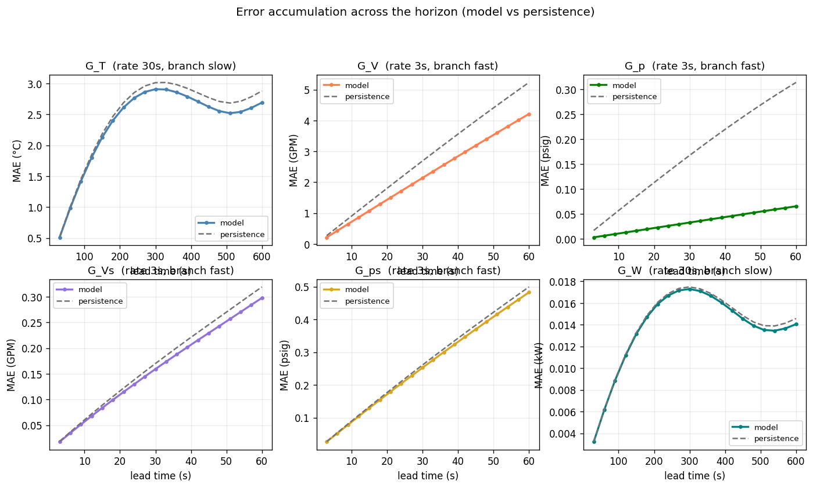
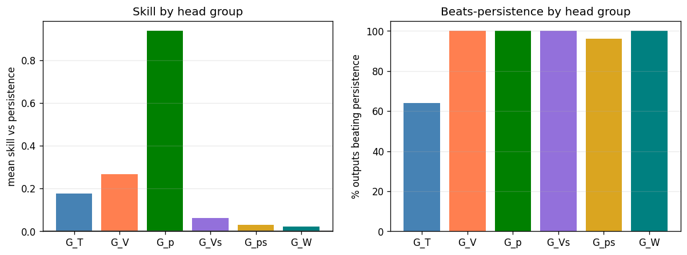

# Phase 5 (federated) — `frontier_phase5_mr_allheads_200h`

*Generated 2026-09-30 19:58:28 · FederatedDeepMMNet · 2,273,486 parameters · 16.1 min*

## Run notes

Frontier (Simulator_olcf5_base, 25 CDUs) baseline: Phase 5 grouped DeepMMNet with the Summit-derived task spec, on systematic-25 (8 chunks x 3.23 h). Pipeline check, not a tuned model.

## Headline

| metric | value |
| --- | --- |
| Outputs | 275 |
| Mean R² | 0.5124 |
| Median R² | 0.9052 |
| Min R² | -0.4921 |
| Beats persistence | 86.2% |
| **Mean skill score** | **+0.2720** |

> Skill vs persistence is the headline metric, not mean R². Several channels sit at their noise floor, where R² is low for *any* predictor including persistence.

## Task (identical across phases 1-6 and run19b)

| group | rate (s) | history | K | window (s) | horizon (s) | branch |
| --- | --- | --- | --- | --- | --- | --- |
| G_T | 30 | 40 | 20 | 1200 | 600 | slow |
| G_V | 3 | 100 | 20 | 300 | 60 | fast |
| G_p | 3 | 100 | 20 | 300 | 60 | fast |
| G_Vs | 3 | 100 | 20 | 300 | 60 | fast |
| G_ps | 3 | 100 | 20 | 300 | 60 | fast |
| G_W | 30 | 40 | 20 | 1200 | 600 | slow |

| split | chunks | windows |
| --- | --- | --- |
| train | [0, 2, 3, 5, 6, 7, 9, 10, 11, 12, 14, 15, 16, 17, 18, 19, 20, 22, 23] | 17,974 |
| val | [4, 21] | 1,892 |
| test | [1, 8, 13] | 2,838 |

## Per head group

| group | outputs | horizon (s) | mean R² | median R² | beats | mean skill |
| --- | --- | --- | --- | --- | --- | --- |
| G_T | 100 | 600 | 0.0502 | -0.2186 | 64/100 (64%) | +0.1765 |
| G_V | 25 | 60 | 0.9827 | 0.9826 | 25/25 (100%) | +0.2670 |
| G_p | 50 | 60 | 0.9974 | 0.9974 | 50/50 (100%) | +0.9366 |
| G_Vs | 25 | 60 | 0.8692 | 0.8676 | 25/25 (100%) | +0.0633 |
| G_ps | 50 | 60 | 0.9102 | 0.9096 | 48/50 (96%) | +0.0299 |
| G_W | 25 | 600 | -0.2315 | -0.2362 | 25/25 (100%) | +0.0223 |

## Per output type

| Output_Type | R² mean | R² min | RMSE mean | MAE mean | Beats_Persistence mean |
| --- | --- | --- | --- | --- | --- |
| T_prim_r | -0.3223 | -0.4921 | 4.9447 | 3.4641 | 0.3200 |
| T_prim_s | 0.9742 | 0.9742 | 0.6294 | 0.3132 | 1.0000 |
| T_sec_r | -0.2072 | -0.3748 | 4.8723 | 3.3834 | 0.3600 |
| T_sec_s | -0.2438 | -0.3934 | 3.1801 | 2.2700 | 0.8800 |
| V_flow_prim | 0.9827 | 0.9806 | 3.2282 | 2.2354 | 1.0000 |
| V_flow_sec | 0.8692 | 0.8568 | 0.2777 | 0.1631 | 1.0000 |
| W_flow | -0.2315 | -0.3818 | 0.0191 | 0.0136 | 1.0000 |
| p_prim_r | 0.9956 | 0.9956 | 0.0742 | 0.0490 | 1.0000 |
| p_prim_s | 0.9992 | 0.9992 | 0.0292 | 0.0202 | 1.0000 |
| p_sec_r | 0.9087 | 0.8930 | 0.4882 | 0.2686 | 0.9600 |
| p_sec_s | 0.9117 | 0.8958 | 0.4622 | 0.2530 | 0.9600 |

## 20 worst outputs by R²

| Output | Group | R² | Skill_Score | RMSE |
| --- | --- | --- | --- | --- |
| simulator[1].datacenter[1].computeBlock[9].cdu[1].summary.T_prim_r_C | G_T | -0.4921 | -0.0035 | 5.0104 |
| simulator[1].datacenter[1].computeBlock[24].cdu[1].summary.T_prim_r_C | G_T | -0.4306 | -0.0066 | 5.7386 |
| simulator[1].datacenter[1].computeBlock[8].cdu[1].summary.T_prim_r_C | G_T | -0.4285 | 0.0085 | 4.9519 |
| simulator[1].datacenter[1].computeBlock[25].cdu[1].summary.T_prim_r_C | G_T | -0.4270 | -0.0188 | 4.9889 |
| simulator[1].datacenter[1].computeBlock[20].cdu[1].summary.T_prim_r_C | G_T | -0.3971 | -0.0105 | 4.2665 |
| simulator[1].datacenter[1].computeBlock[3].cdu[1].summary.T_prim_r_C | G_T | -0.3954 | -0.0034 | 5.4423 |
| simulator[1].datacenter[1].computeBlock[9].cdu[1].summary.T_sec_s_C | G_T | -0.3934 | 0.0057 | 3.2285 |
| simulator[1].datacenter[1].computeBlock[21].cdu[1].summary.T_prim_r_C | G_T | -0.3880 | 0.0061 | 4.5420 |
| simulator[1].datacenter[1].computeBlock[9].cdu[1].summary.W_flow_CDUP_kW | G_W | -0.3818 | 0.0111 | 0.0195 |
| simulator[1].datacenter[1].computeBlock[19].cdu[1].summary.T_prim_r_C | G_T | -0.3815 | -0.0196 | 5.0832 |
| simulator[1].datacenter[1].computeBlock[9].cdu[1].summary.T_sec_r_C | G_T | -0.3748 | -0.0018 | 4.9266 |
| simulator[1].datacenter[1].computeBlock[16].cdu[1].summary.T_prim_r_C | G_T | -0.3708 | 0.0111 | 5.0945 |
| simulator[1].datacenter[1].computeBlock[17].cdu[1].summary.T_prim_r_C | G_T | -0.3565 | -0.0127 | 5.0115 |
| simulator[1].datacenter[1].computeBlock[14].cdu[1].summary.T_prim_r_C | G_T | -0.3559 | -0.0022 | 5.5002 |
| simulator[1].datacenter[1].computeBlock[18].cdu[1].summary.T_prim_r_C | G_T | -0.3558 | -0.0010 | 4.8358 |
| simulator[1].datacenter[1].computeBlock[13].cdu[1].summary.T_prim_r_C | G_T | -0.3478 | 0.0230 | 4.9239 |
| simulator[1].datacenter[1].computeBlock[8].cdu[1].summary.T_sec_s_C | G_T | -0.3391 | 0.0163 | 3.2385 |
| simulator[1].datacenter[1].computeBlock[17].cdu[1].summary.T_sec_s_C | G_T | -0.3386 | -0.0008 | 3.2098 |
| simulator[1].datacenter[1].computeBlock[8].cdu[1].summary.W_flow_CDUP_kW | G_W | -0.3338 | 0.0219 | 0.0196 |
| simulator[1].datacenter[1].computeBlock[4].cdu[1].summary.T_prim_r_C | G_T | -0.3334 | -0.0046 | 4.8546 |

## Figures

### Training and validation loss per epoch.



### Skill and beats-persistence fraction versus lead time.



### Mean absolute error across the horizon, model versus persistence, per head.



### Per-head-group skill and beats-persistence.



## Full console log

```text
==========================================================================
PHASE 5 — federated   [frontier_phase5_mr_allheads_200h]
==========================================================================
device: cuda:0
multi_rate: True   store rates (s): [3, 30]
group   rate(s)  history    K  window(s)  horizon(s)  branch
G_T          30       40   20       1200         600  slow
G_V           3      100   20        300          60  fast
G_p           3      100   20        300          60  fast
G_Vs          3      100   20        300          60  fast
G_ps          3      100   20        300          60  fast
G_W          30       40   20       1200         600  slow
data dir: /home/w1b/exa/data/frontier/systematic-200

============================================================
COLUMN IDENTIFICATION (Federated)
============================================================
Input columns:              26
Total dynamic outputs:      275
  G_T  (temperatures):      100
  G_V  (prim flow):         25
  G_p  (prim pressure):     50
  G_Vs (sec flow):          25
  G_ps (sec pressure):      50
  G_W  (pump power):        25
  Per-type index maps:      11 types

inputs: 26   dynamic outputs: 275
[store] present, reusing: /home/w1b/exa/data/frontier/systematic-200/store
[norm] loading shared normalizer: /home/w1b/exa/data/frontier/systematic-200/store/normalizer_shared.json
FederatedNormalizer loaded from /home/w1b/exa/data/frontier/systematic-200/store/normalizer_shared.json
loader workers: 8   batch: 256
Federated store [chunk split]: train=[0, 2, 3, 5, 6, 7, 9, 10, 11, 12, 14, 15, 16, 17, 18, 19, 20, 22, 23] val=[4, 21] test=[1, 8, 13] | multi_rate=True rates=[3, 30]
  windows: train=17974 val=1892 test=2838
DATA MANIFEST: {'train_chunks': [0, 2, 3, 5, 6, 7, 9, 10, 11, 12, 14, 15, 16, 17, 18, 19, 20, 22, 23], 'val_chunks': [4, 21], 'test_chunks': [1, 8, 13], 'windows': {'train': 17974, 'val': 1892, 'test': 2838}}

model: FederatedDeepMMNet   parameters: 2,273,486

--------------------------------------------------------------------------
TRAINING
--------------------------------------------------------------------------

======================================================================
PER-HEAD LOSS NORMALISATION (persistence baseline)
======================================================================
  head       baseline    cfg_w    effective
  G_T    3.993333e-03     1.00   2.5042e+02
  G_V    2.065340e-03     1.00   4.8418e+02
  G_p    2.764306e-03     1.00   3.6175e+02
  G_Vs   4.315114e-03     1.00   2.3174e+02
  G_ps   4.291548e-03     1.00   2.3302e+02
  G_W    4.498793e-03     1.00   2.2228e+02


======================================================================
TRAINING — Phase 5: Federated DeepMMNet
======================================================================

======================================================================
PHASE 1: Round-Robin Training (6 Decoder Heads)
======================================================================

Phase 1 early stopping at epoch 44
Phase 1 best validation loss: 3.884033

======================================================================
PHASE 2: Joint Fine-Tuning (6 Heads)
  Encoder LR: 0.001
  Head LR:    0.0001
======================================================================

Phase 2 early stopping at epoch 42
Phase 2 best validation loss: 3.889964
Phase 2 (3.889964) worse than Phase 1 (3.884033) — restored Phase 1 weights.

Total training time: 955.8s

training done in 16.1 min   best val 3.884033 @ epoch 24
FederatedNormalizer saved to runs/frontier_phase5_mr_allheads_200h/normalizer.json

--------------------------------------------------------------------------
EVALUATION (test split)
--------------------------------------------------------------------------
======================================================================
RESULTS SUMMARY — frontier_phase5_mr_allheads_200h
======================================================================

--- All 275 Outputs ---
  Mean/Median R²:    0.5124 / 0.9052
  Min R²:            -0.4921
  Beats Persistence: 237/275 (86.2%)
  Mean Skill Score:  +0.2720

--- Per Decoder Head Group ---

  G_T (100 outputs, horizon 600s):
    Mean/Median R²: 0.0502 / -0.2186   Beats: 64/100 (64.0%)   Skill: +0.1765   R²-margin: +1.73e-02

  G_V (25 outputs, horizon 60s):
    Mean/Median R²: 0.9827 / 0.9826   Beats: 25/25 (100.0%)   Skill: +0.2670   R²-margin: +6.32e-03

  G_p (50 outputs, horizon 60s):
    Mean/Median R²: 0.9974 / 0.9974   Beats: 50/50 (100.0%)   Skill: +0.9366   R²-margin: +5.29e-02

  G_Vs (25 outputs, horizon 60s):
    Mean/Median R²: 0.8692 / 0.8676   Beats: 25/25 (100.0%)   Skill: +0.0633   R²-margin: +8.78e-03

  G_ps (50 outputs, horizon 60s):
    Mean/Median R²: 0.9102 / 0.9096   Beats: 48/50 (96.0%)   Skill: +0.0299   R²-margin: +2.78e-03

  G_W (25 outputs, horizon 600s):
    Mean/Median R²: -0.2315 / -0.2362   Beats: 25/25 (100.0%)   Skill: +0.0223   R²-margin: +2.78e-02

--- Per Output Type ---
                 R²            RMSE     MAE Beats_Persistence Variance_Ratio
               mean     min    mean    mean              mean           mean
Output_Type                                                                 
T_prim_r    -0.3223 -0.4921  4.9447  3.4641              0.32         1.0082
T_prim_s     0.9742  0.9742  0.6294  0.3132              1.00         1.0703
T_sec_r     -0.2072 -0.3748  4.8723  3.3834              0.36         1.0039
T_sec_s     -0.2438 -0.3934  3.1801  2.2700              0.88         1.0366
V_flow_prim  0.9827  0.9806  3.2282  2.2354              1.00         0.9962
V_flow_sec   0.8692  0.8568  0.2777  0.1631              1.00         0.9822
W_flow      -0.2315 -0.3818  0.0191  0.0136              1.00         0.9908
p_prim_r     0.9956  0.9956  0.0742  0.0490              1.00         1.0038
p_prim_s     0.9992  0.9992  0.0292  0.0202              1.00         1.0030
p_sec_r      0.9087  0.8930  0.4882  0.2686              0.96         0.9778
p_sec_s      0.9117  0.8958  0.4622  0.2530              0.96         0.9777
```

## Artifacts

- `config.json`
- `data_manifest.json`
- `error_accum.png`
- `group_summary.png`
- `history.json`
- `metrics.csv`
- `model.pt`
- `normalizer.json`
- `notes.txt`
- `per_step.npy`
- `phase_summary.json`
- `run_log.txt`
- `skill_vs_lead.png`
- `training_curves.png`
