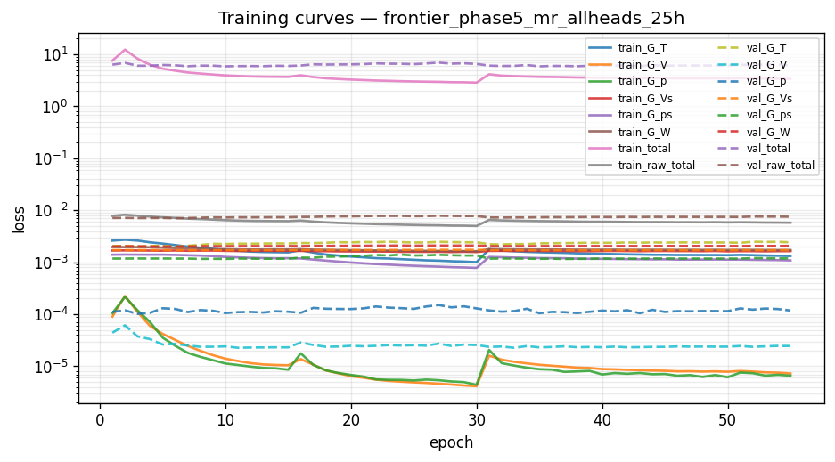
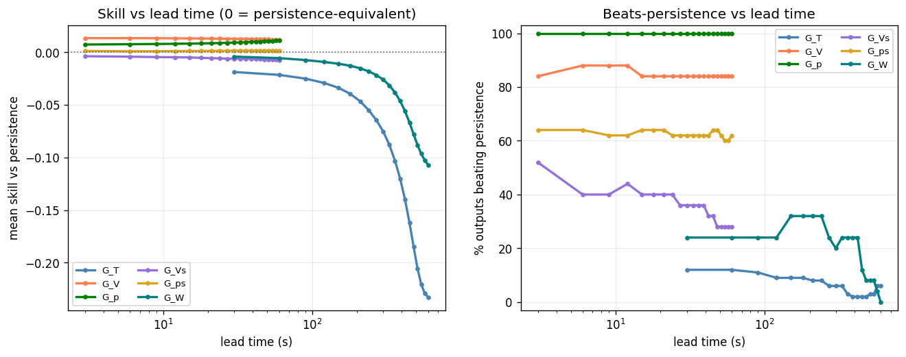
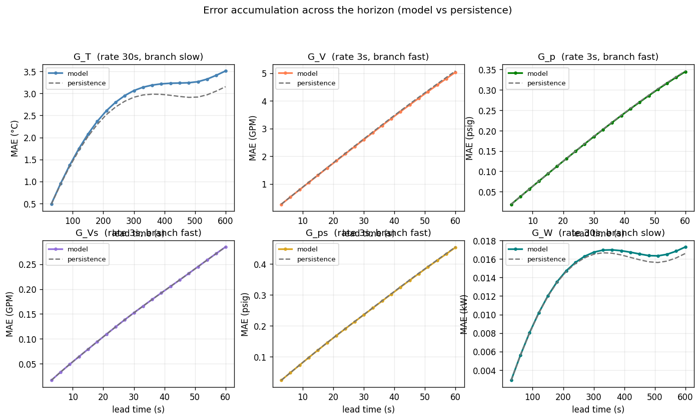
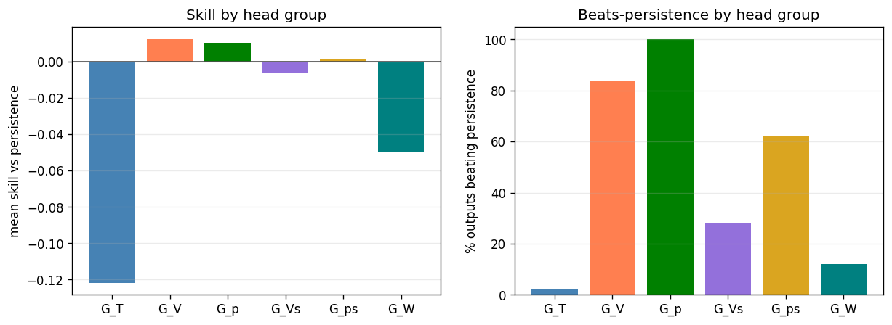

# Phase 5 (federated) — `frontier_phase5_mr_allheads_25h`

*Generated 2026-09-30 16:46:23 · FederatedDeepMMNet · 2,273,486 parameters · 6.8 min*

## Run notes

Frontier (Simulator_olcf5_base, 25 CDUs) baseline: Phase 5 grouped DeepMMNet with the Summit-derived task spec, on systematic-25 (8 chunks x 3.23 h). Pipeline check, not a tuned model.

## Headline

| metric | value |
| --- | --- |
| Outputs | 275 |
| Mean R² | 0.5294 |
| Median R² | 0.8851 |
| Min R² | -0.7169 |
| Beats persistence | 41.5% |
| **Mean skill score** | **-0.0460** |

> Skill vs persistence is the headline metric, not mean R². Several channels sit at their noise floor, where R² is low for *any* predictor including persistence.

## Task (identical across phases 1-6 and run19b)

| group | rate (s) | history | K | window (s) | horizon (s) | branch |
| --- | --- | --- | --- | --- | --- | --- |
| G_T | 30 | 40 | 20 | 1200 | 600 | slow |
| G_V | 3 | 100 | 20 | 300 | 60 | fast |
| G_p | 3 | 100 | 20 | 300 | 60 | fast |
| G_Vs | 3 | 100 | 20 | 300 | 60 | fast |
| G_ps | 3 | 100 | 20 | 300 | 60 | fast |
| G_W | 30 | 40 | 20 | 1200 | 600 | slow |

| split | chunks | windows |
| --- | --- | --- |
| train | [1, 2, 3, 4, 6, 7] | 1,968 |
| val | [5] | 328 |
| test | [0] | 328 |

## Per head group

| group | outputs | horizon (s) | mean R² | median R² | beats | mean skill |
| --- | --- | --- | --- | --- | --- | --- |
| G_T | 100 | 600 | 0.0465 | -0.1253 | 2/100 (2%) | -0.1216 |
| G_V | 25 | 60 | 0.9821 | 0.9827 | 21/25 (84%) | +0.0125 |
| G_p | 50 | 60 | 0.9475 | 0.9475 | 50/50 (100%) | +0.0104 |
| G_Vs | 25 | 60 | 0.8910 | 0.8925 | 7/25 (28%) | -0.0065 |
| G_ps | 50 | 60 | 0.9215 | 0.9212 | 31/50 (62%) | +0.0016 |
| G_W | 25 | 600 | 0.0263 | -0.0112 | 3/25 (12%) | -0.0496 |

## Per output type

| Output_Type | R² mean | R² min | RMSE mean | MAE mean | Beats_Persistence mean |
| --- | --- | --- | --- | --- | --- |
| T_prim_r | -0.3482 | -0.7169 | 4.9376 | 3.6007 | 0.0000 |
| T_prim_s | 0.8845 | 0.8832 | 1.5066 | 1.0882 | 0.0800 |
| T_sec_r | -0.2233 | -0.6365 | 4.8836 | 3.5349 | 0.0000 |
| T_sec_s | -0.1268 | -0.5697 | 3.2298 | 2.4138 | 0.0000 |
| V_flow_prim | 0.9821 | 0.9753 | 3.6098 | 2.7001 | 0.8400 |
| V_flow_sec | 0.8910 | 0.8311 | 0.2574 | 0.1556 | 0.2800 |
| W_flow | 0.0263 | -0.4843 | 0.0190 | 0.0142 | 0.1200 |
| p_prim_r | 0.9035 | 0.9035 | 0.3964 | 0.2966 | 1.0000 |
| p_prim_s | 0.9914 | 0.9914 | 0.1106 | 0.0823 | 1.0000 |
| p_sec_r | 0.9203 | 0.8798 | 0.4520 | 0.2519 | 0.6000 |
| p_sec_s | 0.9228 | 0.8812 | 0.4283 | 0.2369 | 0.6400 |

## 20 worst outputs by R²

| Output | Group | R² | Skill_Score | RMSE |
| --- | --- | --- | --- | --- |
| simulator[1].datacenter[1].computeBlock[13].cdu[1].summary.T_prim_r_C | G_T | -0.7169 | -0.1234 | 7.3027 |
| simulator[1].datacenter[1].computeBlock[21].cdu[1].summary.T_prim_r_C | G_T | -0.6791 | -0.2195 | 4.1392 |
| simulator[1].datacenter[1].computeBlock[21].cdu[1].summary.T_sec_r_C | G_T | -0.6365 | -0.2894 | 4.1584 |
| simulator[1].datacenter[1].computeBlock[16].cdu[1].summary.T_prim_r_C | G_T | -0.5989 | -0.1711 | 4.6284 |
| simulator[1].datacenter[1].computeBlock[13].cdu[1].summary.T_sec_r_C | G_T | -0.5844 | -0.1253 | 7.0735 |
| simulator[1].datacenter[1].computeBlock[13].cdu[1].summary.T_sec_s_C | G_T | -0.5697 | -0.1173 | 4.9088 |
| simulator[1].datacenter[1].computeBlock[7].cdu[1].summary.T_prim_r_C | G_T | -0.5447 | -0.1115 | 5.6946 |
| simulator[1].datacenter[1].computeBlock[2].cdu[1].summary.T_prim_r_C | G_T | -0.5222 | -0.1192 | 4.8932 |
| simulator[1].datacenter[1].computeBlock[13].cdu[1].summary.W_flow_CDUP_kW | G_W | -0.4843 | -0.0352 | 0.0286 |
| simulator[1].datacenter[1].computeBlock[14].cdu[1].summary.T_prim_r_C | G_T | -0.4801 | -0.1853 | 4.7748 |
| simulator[1].datacenter[1].computeBlock[4].cdu[1].summary.T_prim_r_C | G_T | -0.4701 | -0.0360 | 5.9500 |
| simulator[1].datacenter[1].computeBlock[18].cdu[1].summary.T_prim_r_C | G_T | -0.4664 | -0.1915 | 4.9931 |
| simulator[1].datacenter[1].computeBlock[9].cdu[1].summary.T_prim_r_C | G_T | -0.4329 | -0.0247 | 6.2331 |
| simulator[1].datacenter[1].computeBlock[6].cdu[1].summary.T_prim_r_C | G_T | -0.4318 | -0.6823 | 3.2160 |
| simulator[1].datacenter[1].computeBlock[4].cdu[1].summary.T_sec_r_C | G_T | -0.4160 | -0.0252 | 5.8673 |
| simulator[1].datacenter[1].computeBlock[25].cdu[1].summary.T_prim_r_C | G_T | -0.3939 | -0.0355 | 5.5214 |
| simulator[1].datacenter[1].computeBlock[7].cdu[1].summary.T_sec_r_C | G_T | -0.3913 | -0.0907 | 5.6852 |
| simulator[1].datacenter[1].computeBlock[2].cdu[1].summary.T_sec_r_C | G_T | -0.3889 | -0.1171 | 4.8880 |
| simulator[1].datacenter[1].computeBlock[22].cdu[1].summary.T_prim_r_C | G_T | -0.3783 | -0.0162 | 5.4567 |
| simulator[1].datacenter[1].computeBlock[16].cdu[1].summary.T_sec_r_C | G_T | -0.3702 | -0.1592 | 4.4716 |

## Figures

### Training and validation loss per epoch.



### Skill and beats-persistence fraction versus lead time.



### Mean absolute error across the horizon, model versus persistence, per head.



### Per-head-group skill and beats-persistence.



## Full console log

```text
==========================================================================
PHASE 5 — federated   [frontier_phase5_mr_allheads_25h]
==========================================================================
device: cuda:0
multi_rate: True   store rates (s): [3, 30]
group   rate(s)  history    K  window(s)  horizon(s)  branch
G_T          30       40   20       1200         600  slow
G_V           3      100   20        300          60  fast
G_p           3      100   20        300          60  fast
G_Vs          3      100   20        300          60  fast
G_ps          3      100   20        300          60  fast
G_W          30       40   20       1200         600  slow
data dir: /home/w1b/exa/data/frontier/systematic-25

============================================================
COLUMN IDENTIFICATION (Federated)
============================================================
Input columns:              26
Total dynamic outputs:      275
  G_T  (temperatures):      100
  G_V  (prim flow):         25
  G_p  (prim pressure):     50
  G_Vs (sec flow):          25
  G_ps (sec pressure):      50
  G_W  (pump power):        25
  Per-type index maps:      11 types

inputs: 26   dynamic outputs: 275
[store] present, reusing: /home/w1b/exa/data/frontier/systematic-25/store
[norm] loading shared normalizer: /home/w1b/exa/data/frontier/systematic-25/store/normalizer_shared.json
FederatedNormalizer loaded from /home/w1b/exa/data/frontier/systematic-25/store/normalizer_shared.json
loader workers: 4   batch: 256
Federated store [chunk split]: train=[1, 2, 3, 4, 6, 7] val=[5] test=[0] | multi_rate=True rates=[3, 30]
  windows: train=1968 val=328 test=328
DATA MANIFEST: {'train_chunks': [1, 2, 3, 4, 6, 7], 'val_chunks': [5], 'test_chunks': [0], 'windows': {'train': 1968, 'val': 328, 'test': 328}}

model: FederatedDeepMMNet   parameters: 2,273,486

--------------------------------------------------------------------------
TRAINING
--------------------------------------------------------------------------

======================================================================
PER-HEAD LOSS NORMALISATION (persistence baseline)
======================================================================
  head       baseline    cfg_w    effective
  G_T    2.571589e-03     1.00   3.8886e+02
  G_V    4.537733e-05     1.00   2.2037e+04
  G_p    6.549651e-05     1.00   1.5268e+04
  G_Vs   1.698397e-03     1.00   5.8879e+02
  G_ps   1.401437e-03     1.00   7.1355e+02
  G_W    1.971237e-03     1.00   5.0730e+02


======================================================================
TRAINING — Phase 5: Federated DeepMMNet
======================================================================

======================================================================
PHASE 1: Round-Robin Training (6 Decoder Heads)
======================================================================

Phase 1 early stopping at epoch 30
Phase 1 best validation loss: 5.891652

======================================================================
PHASE 2: Joint Fine-Tuning (6 Heads)
  Encoder LR: 0.001
  Head LR:    0.0001
======================================================================

Phase 2 early stopping at epoch 25
Phase 2 best validation loss: 5.886608

Total training time: 405.5s

training done in 6.8 min   best val 5.886608 @ epoch 35
FederatedNormalizer saved to runs/frontier_phase5_mr_allheads_25h/normalizer.json

--------------------------------------------------------------------------
EVALUATION (test split)
--------------------------------------------------------------------------
======================================================================
RESULTS SUMMARY — frontier_phase5_mr_allheads_25h
======================================================================

--- All 275 Outputs ---
  Mean/Median R²:    0.5294 / 0.8851
  Min R²:            -0.7169
  Beats Persistence: 114/275 (41.5%)
  Mean Skill Score:  -0.0460

--- Per Decoder Head Group ---

  G_T (100 outputs, horizon 600s):
    Mean/Median R²: 0.0465 / -0.1253   Beats: 2/100 (2.0%)   Skill: -0.1216   R²-margin: -1.13e-01

  G_V (25 outputs, horizon 60s):
    Mean/Median R²: 0.9821 / 0.9827   Beats: 21/25 (84.0%)   Skill: +0.0125   R²-margin: +2.26e-04

  G_p (50 outputs, horizon 60s):
    Mean/Median R²: 0.9475 / 0.9475   Beats: 50/50 (100.0%)   Skill: +0.0104   R²-margin: +4.31e-04

  G_Vs (25 outputs, horizon 60s):
    Mean/Median R²: 0.8910 / 0.8925   Beats: 7/25 (28.0%)   Skill: -0.0065   R²-margin: -6.87e-04

  G_ps (50 outputs, horizon 60s):
    Mean/Median R²: 0.9215 / 0.9212   Beats: 31/50 (62.0%)   Skill: +0.0016   R²-margin: +1.94e-04

  G_W (25 outputs, horizon 600s):
    Mean/Median R²: 0.0263 / -0.0112   Beats: 3/25 (12.0%)   Skill: -0.0496   R²-margin: -4.15e-02

--- Per Output Type ---
                 R²            RMSE     MAE Beats_Persistence Variance_Ratio
               mean     min    mean    mean              mean           mean
Output_Type                                                                 
T_prim_r    -0.3482 -0.7169  4.9376  3.6007              0.00         1.0845
T_prim_s     0.8845  0.8832  1.5066  1.0882              0.08         1.0179
T_sec_r     -0.2233 -0.6365  4.8836  3.5349              0.00         1.0587
T_sec_s     -0.1268 -0.5697  3.2298  2.4138              0.00         1.0681
V_flow_prim  0.9821  0.9753  3.6098  2.7001              0.84         1.0020
V_flow_sec   0.8910  0.8311  0.2574  0.1556              0.28         0.9979
W_flow       0.0263 -0.4843  0.0190  0.0142              0.12         1.1631
p_prim_r     0.9035  0.9035  0.3964  0.2966              1.00         0.9984
p_prim_s     0.9914  0.9914  0.1106  0.0823              1.00         1.0004
p_sec_r      0.9203  0.8798  0.4520  0.2519              0.60         0.9952
p_sec_s      0.9228  0.8812  0.4283  0.2369              0.64         0.9940
```

## Artifacts

- `config.json`
- `data_manifest.json`
- `error_accum.png`
- `group_summary.png`
- `history.json`
- `metrics.csv`
- `model.pt`
- `normalizer.json`
- `notes.txt`
- `per_step.npy`
- `phase_summary.json`
- `run_log.txt`
- `skill_vs_lead.png`
- `training_curves.png`
