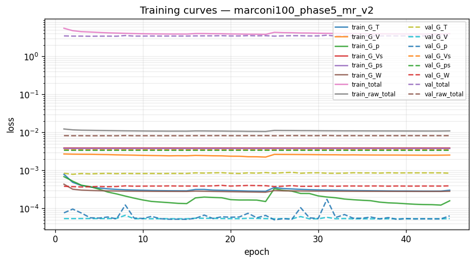
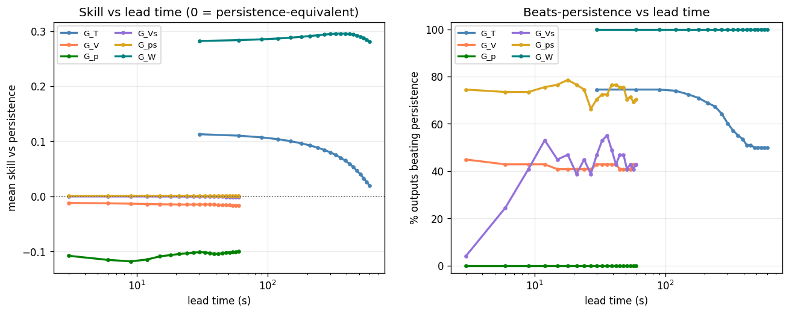
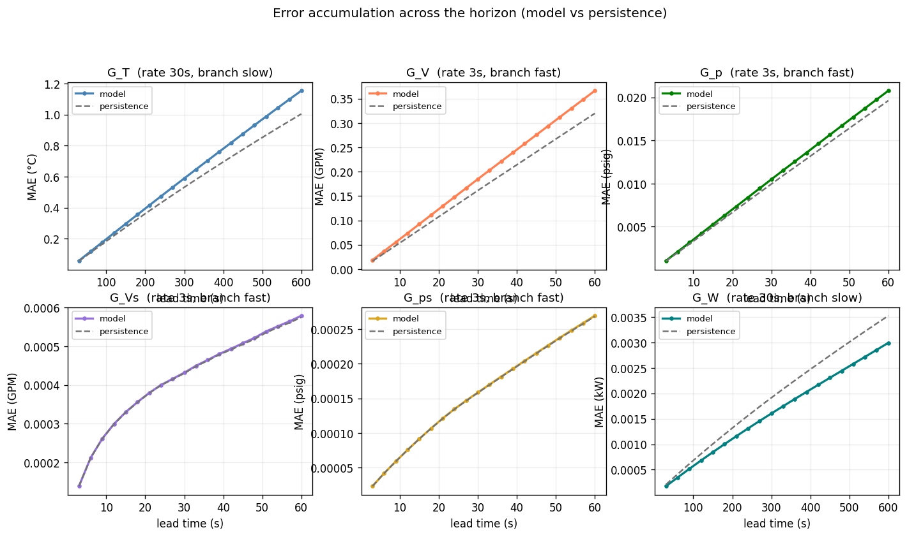
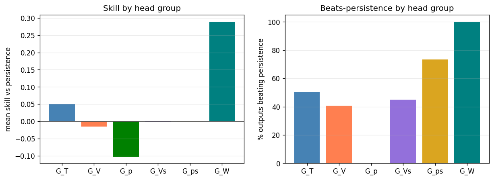

# Phase 5 (federated) — `marconi100_phase5_mr_v2`

*Generated 2026-10-05 16:15:48 · FederatedDeepMMNet · 2,668,350 parameters · 15.6 min*

## Run notes

marconi100 (49 CDUs): Phase 5 grouped DeepMMNet, run_phase5.py config, head weights {'G_T': 1.0, 'G_V': 1.0, 'G_p': 1.0, 'G_Vs': 1.0, 'G_ps': 1.0, 'G_W': 1.0}, data systematic-200h-v2.

## Headline

| metric | value |
| --- | --- |
| Outputs | 539 |
| Mean R² | 0.9613 |
| Median R² | 0.9855 |
| Min R² | 0.6349 |
| Beats persistence | 48.6% |
| **Mean skill score** | **+0.0249** |

> Skill vs persistence is the headline metric, not mean R². Several channels sit at their noise floor, where R² is low for *any* predictor including persistence.

## Task (identical across phases 1-6 and run19b)

| group | rate (s) | history | K | window (s) | horizon (s) | branch |
| --- | --- | --- | --- | --- | --- | --- |
| G_T | 30 | 40 | 20 | 1200 | 600 | slow |
| G_V | 3 | 100 | 20 | 300 | 60 | fast |
| G_p | 3 | 100 | 20 | 300 | 60 | fast |
| G_Vs | 3 | 100 | 20 | 300 | 60 | fast |
| G_ps | 3 | 100 | 20 | 300 | 60 | fast |
| G_W | 30 | 40 | 20 | 1200 | 600 | slow |

| split | chunks | windows |
| --- | --- | --- |
| train | [0, 2, 3, 5, 6, 7, 9, 10, 11, 12, 14, 15, 16, 17, 18, 19, 20, 22, 23] | 17,993 |
| val | [4, 21] | 1,894 |
| test | [1, 8, 13] | 2,841 |

## Per head group

| group | outputs | horizon (s) | mean R² | median R² | beats | mean skill |
| --- | --- | --- | --- | --- | --- | --- |
| G_T | 196 | 600 | 0.9737 | 0.9872 | 99/196 (51%) | +0.0505 |
| G_V | 49 | 60 | 0.9789 | 0.9849 | 20/49 (41%) | -0.0155 |
| G_p | 98 | 60 | 0.9990 | 0.9990 | 0/98 (0%) | -0.1021 |
| G_Vs | 49 | 60 | 0.7645 | 0.7624 | 22/49 (45%) | -0.0006 |
| G_ps | 98 | 60 | 0.9726 | 0.9730 | 72/98 (73%) | +0.0013 |
| G_W | 49 | 600 | 0.9929 | 0.9932 | 49/49 (100%) | +0.2899 |

## Per output type

| Output_Type | R² mean | R² min | RMSE mean | MAE mean | Beats_Persistence mean |
| --- | --- | --- | --- | --- | --- |
| T_prim_r | 0.9777 | 0.9621 | 0.8590 | 0.5321 | 0.0204 |
| T_prim_s | 0.9317 | 0.9309 | 1.7520 | 1.1815 | 0.0000 |
| T_sec_r | 0.9926 | 0.9881 | 0.5307 | 0.3752 | 1.0000 |
| T_sec_s | 0.9928 | 0.9886 | 0.5202 | 0.3675 | 1.0000 |
| V_flow_prim | 0.9789 | 0.9300 | 1.6652 | 0.1931 | 0.4082 |
| V_flow_sec | 0.7645 | 0.6349 | 0.0010 | 0.0004 | 0.4490 |
| W_flow | 0.9929 | 0.9888 | 0.0023 | 0.0016 | 1.0000 |
| p_prim_r | 0.9993 | 0.9993 | 0.0507 | 0.0138 | 0.0000 |
| p_prim_s | 0.9987 | 0.9987 | 0.0268 | 0.0081 | 0.0000 |
| p_sec_r | 0.9726 | 0.9546 | 0.0004 | 0.0002 | 0.7347 |
| p_sec_s | 0.9726 | 0.9546 | 0.0004 | 0.0002 | 0.7347 |

## 20 worst outputs by R²

| Output | Group | R² | Skill_Score | RMSE |
| --- | --- | --- | --- | --- |
| simulator[1].datacenter[1].computeBlock[29].cdu[1].summary.V_flow_sec_GPM | G_Vs | 0.6349 | -0.0015 | 0.0012 |
| simulator[1].datacenter[1].computeBlock[9].cdu[1].summary.V_flow_sec_GPM | G_Vs | 0.6628 | -0.0003 | 0.0013 |
| simulator[1].datacenter[1].computeBlock[7].cdu[1].summary.V_flow_sec_GPM | G_Vs | 0.6804 | -0.0003 | 0.0013 |
| simulator[1].datacenter[1].computeBlock[32].cdu[1].summary.V_flow_sec_GPM | G_Vs | 0.7015 | 0.0003 | 0.0013 |
| simulator[1].datacenter[1].computeBlock[35].cdu[1].summary.V_flow_sec_GPM | G_Vs | 0.7067 | -0.0016 | 0.0012 |
| simulator[1].datacenter[1].computeBlock[39].cdu[1].summary.V_flow_sec_GPM | G_Vs | 0.7106 | -0.0017 | 0.0013 |
| simulator[1].datacenter[1].computeBlock[6].cdu[1].summary.V_flow_sec_GPM | G_Vs | 0.7143 | 0.0002 | 0.0013 |
| simulator[1].datacenter[1].computeBlock[27].cdu[1].summary.V_flow_sec_GPM | G_Vs | 0.7154 | -0.0016 | 0.0011 |
| simulator[1].datacenter[1].computeBlock[21].cdu[1].summary.V_flow_sec_GPM | G_Vs | 0.7187 | 0.0002 | 0.0011 |
| simulator[1].datacenter[1].computeBlock[19].cdu[1].summary.V_flow_sec_GPM | G_Vs | 0.7209 | -0.0001 | 0.0012 |
| simulator[1].datacenter[1].computeBlock[42].cdu[1].summary.V_flow_sec_GPM | G_Vs | 0.7245 | 0.0007 | 0.0012 |
| simulator[1].datacenter[1].computeBlock[48].cdu[1].summary.V_flow_sec_GPM | G_Vs | 0.7303 | -0.0025 | 0.0011 |
| simulator[1].datacenter[1].computeBlock[18].cdu[1].summary.V_flow_sec_GPM | G_Vs | 0.7324 | 0.0008 | 0.0010 |
| simulator[1].datacenter[1].computeBlock[34].cdu[1].summary.V_flow_sec_GPM | G_Vs | 0.7366 | -0.0045 | 0.0011 |
| simulator[1].datacenter[1].computeBlock[25].cdu[1].summary.V_flow_sec_GPM | G_Vs | 0.7389 | -0.0005 | 0.0010 |
| simulator[1].datacenter[1].computeBlock[38].cdu[1].summary.V_flow_sec_GPM | G_Vs | 0.7411 | -0.0008 | 0.0011 |
| simulator[1].datacenter[1].computeBlock[44].cdu[1].summary.V_flow_sec_GPM | G_Vs | 0.7418 | 0.0004 | 0.0010 |
| simulator[1].datacenter[1].computeBlock[28].cdu[1].summary.V_flow_sec_GPM | G_Vs | 0.7419 | -0.0062 | 0.0011 |
| simulator[1].datacenter[1].computeBlock[17].cdu[1].summary.V_flow_sec_GPM | G_Vs | 0.7468 | -0.0002 | 0.0011 |
| simulator[1].datacenter[1].computeBlock[36].cdu[1].summary.V_flow_sec_GPM | G_Vs | 0.7480 | -0.0006 | 0.0010 |

## Figures

### Training and validation loss per epoch.



### Skill and beats-persistence fraction versus lead time.



### Mean absolute error across the horizon, model versus persistence, per head.



### Per-head-group skill and beats-persistence.



## Full console log

```text
==========================================================================
PHASE 5 — federated   [marconi100_phase5_mr_v2]
==========================================================================
device: cuda:0
multi_rate: True   store rates (s): [3, 30]
group   rate(s)  history    K  window(s)  horizon(s)  branch
G_T          30       40   20       1200         600  slow
G_V           3      100   20        300          60  fast
G_p           3      100   20        300          60  fast
G_Vs          3      100   20        300          60  fast
G_ps          3      100   20        300          60  fast
G_W          30       40   20       1200         600  slow
data dir: /home/w1b/exa/data/marconi100/systematic-200h-v2

============================================================
COLUMN IDENTIFICATION (Federated)
============================================================
Input columns:              99
Total dynamic outputs:      539
  G_T  (temperatures):      196
  G_V  (prim flow):         49
  G_p  (prim pressure):     98
  G_Vs (sec flow):          49
  G_ps (sec pressure):      98
  G_W  (pump power):        49
  Per-type index maps:      11 types

inputs: 99   dynamic outputs: 539
[store] present, reusing: /home/w1b/exa/data/marconi100/systematic-200h-v2/store
[norm] loading shared normalizer: /home/w1b/exa/data/marconi100/systematic-200h-v2/store/normalizer_shared.json
FederatedNormalizer loaded from /home/w1b/exa/data/marconi100/systematic-200h-v2/store/normalizer_shared.json
loader workers: 8   batch: 256
Federated store [chunk split]: train=[0, 2, 3, 5, 6, 7, 9, 10, 11, 12, 14, 15, 16, 17, 18, 19, 20, 22, 23] val=[4, 21] test=[1, 8, 13] | multi_rate=True rates=[3, 30]
  windows: train=17993 val=1894 test=2841
DATA MANIFEST: {'train_chunks': [0, 2, 3, 5, 6, 7, 9, 10, 11, 12, 14, 15, 16, 17, 18, 19, 20, 22, 23], 'val_chunks': [4, 21], 'test_chunks': [1, 8, 13], 'windows': {'train': 17993, 'val': 1894, 'test': 2841}}

model: FederatedDeepMMNet   parameters: 2,668,350

--------------------------------------------------------------------------
TRAINING
--------------------------------------------------------------------------

======================================================================
PER-HEAD LOSS NORMALISATION (persistence baseline)
======================================================================
  head       baseline    cfg_w    effective
  G_T    9.933863e-04     1.00   1.0067e+03
  G_V    2.720370e-03     1.00   3.6760e+02
  G_p    7.556855e-04     1.00   1.3233e+03
  G_Vs   3.926249e-03     1.00   2.5470e+02
  G_ps   3.818886e-03     1.00   2.6186e+02
  G_W    5.308454e-04     1.00   1.8838e+03


======================================================================
TRAINING — Phase 5: Federated DeepMMNet
======================================================================

======================================================================
PHASE 1: Round-Robin Training (6 Decoder Heads)
======================================================================

Phase 1 early stopping at epoch 24
Phase 1 best validation loss: 3.400782

======================================================================
PHASE 2: Joint Fine-Tuning (6 Heads)
  Encoder LR: 0.001
  Head LR:    0.0001
======================================================================

Phase 2 early stopping at epoch 21
Phase 2 best validation loss: 3.432225
Phase 2 (3.432225) worse than Phase 1 (3.400782) — restored Phase 1 weights.

Total training time: 919.7s

training done in 15.6 min   best val 3.400782 @ epoch 4
FederatedNormalizer saved to runs/marconi100_phase5_mr_v2/normalizer.json

--------------------------------------------------------------------------
EVALUATION (test split)
--------------------------------------------------------------------------
======================================================================
RESULTS SUMMARY — marconi100_phase5_mr_v2
======================================================================

--- All 539 Outputs ---
  Mean/Median R²:    0.9613 / 0.9855
  Min R²:            0.6349
  Beats Persistence: 262/539 (48.6%)
  Mean Skill Score:  +0.0249

--- Per Decoder Head Group ---

  G_T (196 outputs, horizon 600s):
    Mean/Median R²: 0.9737 / 0.9872   Beats: 99/196 (50.5%)   Skill: +0.0505   R²-margin: -2.78e-03

  G_V (49 outputs, horizon 60s):
    Mean/Median R²: 0.9789 / 0.9849   Beats: 20/49 (40.8%)   Skill: -0.0155   R²-margin: -4.26e-04

  G_p (98 outputs, horizon 60s):
    Mean/Median R²: 0.9990 / 0.9990   Beats: 0/98 (0.0%)   Skill: -0.1021   R²-margin: -9.78e-05

  G_Vs (49 outputs, horizon 60s):
    Mean/Median R²: 0.7645 / 0.7624   Beats: 22/49 (44.9%)   Skill: -0.0006   R²-margin: -1.34e-04

  G_ps (98 outputs, horizon 60s):
    Mean/Median R²: 0.9726 / 0.9730   Beats: 72/98 (73.5%)   Skill: +0.0013   R²-margin: +3.46e-05

  G_W (49 outputs, horizon 600s):
    Mean/Median R²: 0.9929 / 0.9932   Beats: 49/49 (100.0%)   Skill: +0.2899   R²-margin: +2.87e-03

--- Per Output Type ---
                 R²            RMSE     MAE Beats_Persistence Variance_Ratio
               mean     min    mean    mean              mean           mean
Output_Type                                                                 
T_prim_r     0.9777  0.9621  0.8590  0.5321            0.0204         0.9888
T_prim_s     0.9317  0.9309  1.7520  1.1815            0.0000         0.9472
T_sec_r      0.9926  0.9881  0.5307  0.3752            1.0000         0.9956
T_sec_s      0.9928  0.9886  0.5202  0.3675            1.0000         0.9957
V_flow_prim  0.9789  0.9300  1.6652  0.1931            0.4082         1.0114
V_flow_sec   0.7645  0.6349  0.0010  0.0004            0.4490         0.9973
W_flow       0.9929  0.9888  0.0023  0.0016            1.0000         0.9896
p_prim_r     0.9993  0.9993  0.0507  0.0138            0.0000         0.9884
p_prim_s     0.9987  0.9987  0.0268  0.0081            0.0000         0.9880
p_sec_r      0.9726  0.9546  0.0004  0.0002            0.7347         0.9899
p_sec_s      0.9726  0.9546  0.0004  0.0002            0.7347         0.9900
```

## Artifacts

- `config.json`
- `data_manifest.json`
- `error_accum.png`
- `group_summary.png`
- `history.json`
- `metrics.csv`
- `model.pt`
- `normalizer.json`
- `notes.txt`
- `per_step.npy`
- `phase_summary.json`
- `run_log.txt`
- `skill_vs_lead.png`
- `training_curves.png`
